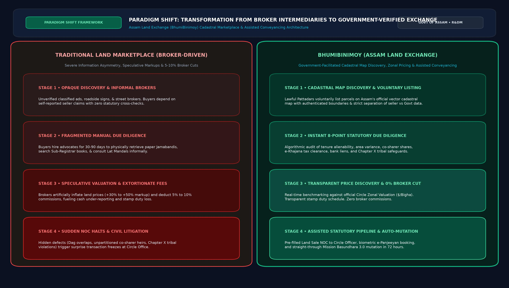
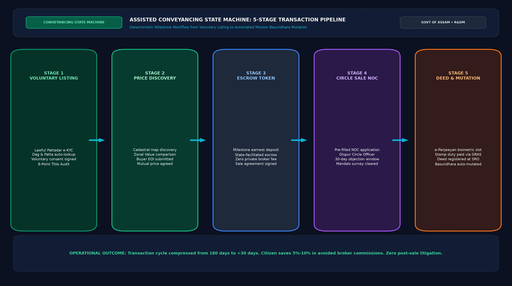
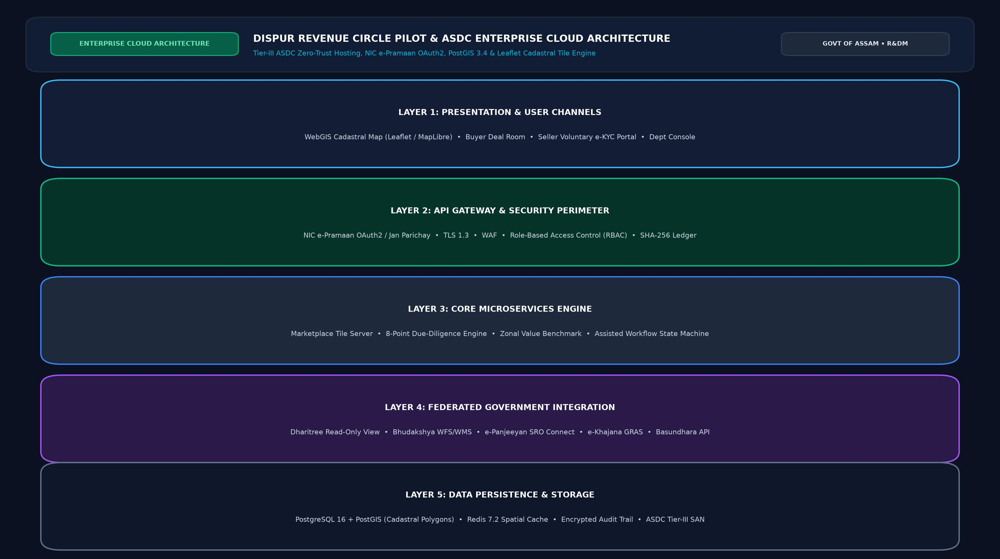
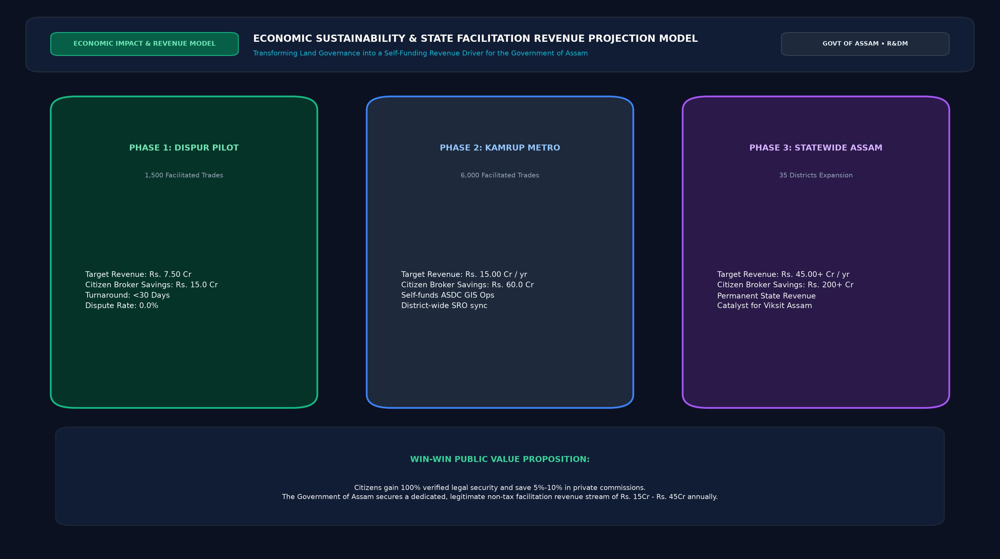

# Assam Land Exchange • BhumiBinimoy (ভূমি বিনিময়)
### Government-Verified Cadastral Marketplace for Buying and Selling Land

[](https://bhumi-swasthya.pages.dev/)
[](https://landrecords.assam.gov.in/)
[](https://startup.assam.gov.in/nesfic26/problem-statements/nesfic-d-52)
[](https://bhumi-swasthya.pages.dev/)
[](https://react.dev/)
[](https://leafletjs.com/)

> 🌐 **Live Interactive Prototype:** **[https://bhumi-swasthya.pages.dev/](https://bhumi-swasthya.pages.dev/)**  
> Explore the Cadastral Marketplace Explorer, Buyer Due-Diligence Deal Room, Voluntary Landowner Listing Wizard, Assisted 5-Stage Conveyancing Pipeline, and the Revenue Department Super Admin Console.

---

## 🏛️ Executive Summary

**BhumiBinimoy (Assam Land Exchange)** is an interactive, cadastral-map-based digital marketplace and assisted conveyancing engine developed for the **Revenue & Disaster Management Department, Government of Assam** under **NESFIC-D-52 (Stream 1 — Government Track)**.

Traditional land commerce in Assam is constrained by extreme opacity, speculative broker pricing, and fragmented record verification across *Dharitree*, *Bhudakshya*, *e-Panjeeyan*, and *e-Khajana*. Prospective buyers cannot easily verify whether a plot has clear title, while genuine landowners lack a government-backed platform to voluntarily sell land without losing 5% to 10% to informal intermediaries.

**BhumiBinimoy transforms this paradigm into a trusted, state-facilitated exchange:**
1. **Cadastral Map Marketplace:** Lawful Pattadars voluntarily list parcels overlaid as interactive vector polygons on Assam’s official cadastral maps (*Bhudakshya*).
2. **Strict Demarcation of Truth:** Clear distinction between **Government-Verified Official Records** (immutable Dag/Patta, BKL area, Touzi demand, liens, Chapter X tribal status) and **Seller Representations** (asking price, highlights, road width, amenities).
3. **8-Point Title Due-Diligence Engine:** Instant algorithmic reconciliation yielding a composite Title Score (0–100) and badges (*Gold Verified*, *Silver Verified*, *Conditional Transfer*, *Restricted*).
4. **Transparent Price Discovery:** Benchmarks asking prices against gazetted Circle-level **Zonal Valuation Rates** ($₹/\text{Bigha}$) and calculates transparent statutory stamp duty (6%) and registration fees (2%).
5. **Assisted Conveyancing State Machine:** Guides parties through Expression of Interest (EOI), milestone escrow token deposit, automated pre-filled Circle Officer Sale NOC application, and Sub-Registrar biometric booking (*e-Panjeeyan*) leading to *Mission Basundhara 3.0* auto-mutation.
6. **State Facilitation Revenue:** Establishes an optional statutory facilitation fee (0.25%–0.50%), projecting **₹7.5 to ₹15 Crore in annual non-tax revenue** for the State during the Dispur pilot alone.

---

## 📸 Architectural Visualizations & Evidentiary Diagrams

### 1. Paradigm Shift: Fragmented Broker Market vs. Assam Land Exchange


### 2. Integrated Data Ecosystem (Dharitree, Bhudakshya, e-Panjeeyan, e-Khajana)


### 3. Assisted Conveyancing State Machine (5-Stage Transaction Pipeline)


### 4. 8-Point Statutory Due-Diligence & Verification Badge Hierarchy


### 5. Transparent Price Discovery & Zonal Value Benchmarking Engine


### 6. Dispur Circle Pilot & ASDC Enterprise System Architecture


### 7. Economic Sustainability & State Facilitation Revenue Model


---

## 💻 Tech Stack & Infrastructure

- **Web Frontend:** React 18, TypeScript, Tailwind CSS, Lucide Icons, Vite
- **WebGIS Engine:** Leaflet 1.9.4, GeoJSON vector renderers, CartoDB Positron / OSM tiles
- **Geospatial & Calculation Core:** PostGIS 3.4, Assam Standard BKL Engine ($1\text{ Bigha} = 5\text{ Katha} = 100\text{ Lesa} \approx 1337.8038\text{ m}^2$)
- **Edge Deployment:** Cloudflare Pages (Instant edge CDN, SPA client-side routing)
- **Target Government Environment:** Assam State Data Centre (ASDC), Kubernetes (K8s), PostgreSQL 16 + PostGIS, Redis 7.2, NIC e-Pramaan OAuth2

---

## 🚀 Getting Started

### Prerequisites
- Node.js 18+ or 20+
- npm or pnpm
- Python 3.10+ (for PDF & Diagram generation scripts)

### Local Development
```bash
# 1. Install dependencies
npm install

# 2. Start development server
npm run dev
```
Open [http://localhost:5173](http://localhost:5173) in your browser.

### Production Build
```bash
npm run build
```
Compiled production assets are output to `dist/`.

### Generate Official Submission PDFs & Form Text Files
```bash
# Render all architectural diagrams
python3 generate_diagrams.py

# Generate publication-grade PDFs
python3 generate_pdfs.py

# Generate plain-text form submission versions
python3 generate_text_versions.py
```

Generated deliverables:
- `NESFIC_D52_Proposal_Ron_Hatibaruah.pdf`
- `NESFIC_D52_Proof_of_Work_Ron_Hatibaruah.pdf`
- `NESFIC_D52_Proposal_Ron_Hatibaruah.txt`
- `NESFIC_D52_Proof_of_Work_Ron_Hatibaruah.txt`

---

## 🏛️ Sponsoring Department & Competition Track

- **Challenge Track:** NESFIC 2026 (Stream 1 — Government Track)
- **Problem Statement ID:** **NESFIC-D-52**
- **Challenge Title:** *Assam Land Exchange: Government-Verified Marketplace for Buying and Selling Land*
- **Sponsoring Department:** Revenue & Disaster Management Department, Government of Assam
- **Organizer:** Assam Innovation & Startup Foundation (AISF), Dept. of Innovation, Incubation & Startups, Govt. of Assam
- **Lead Applicant:** Ron Hatibaruah
