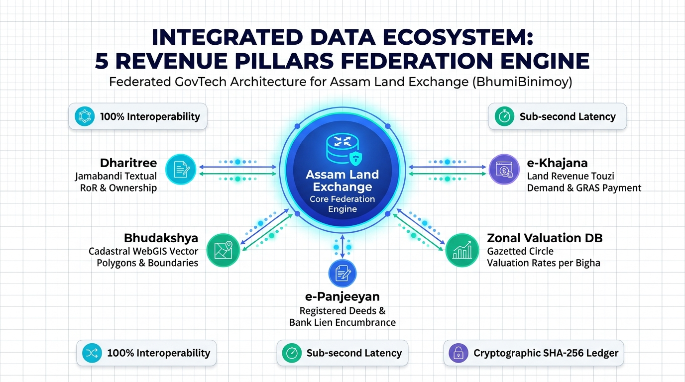
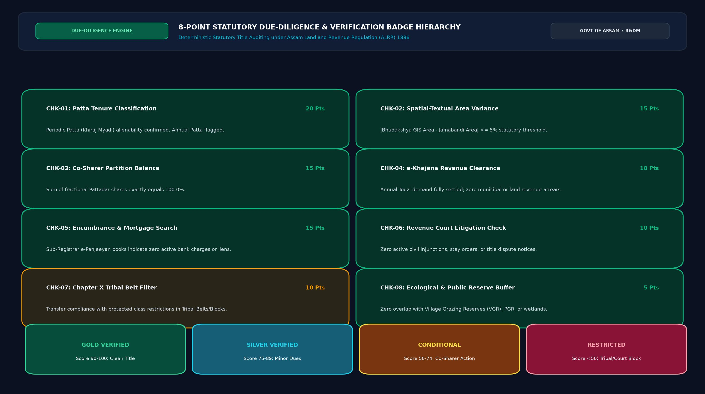
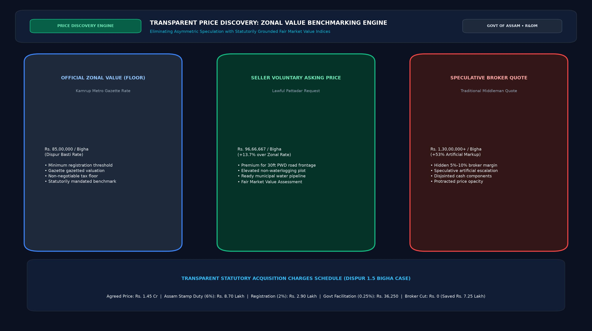

# BhumiSwasthya (ভূমি স্বাস্থ্য)
### Automated Land Records Health-Check & Cadastral Anomaly Detection System

[](https://bhumi-swasthya.pages.dev/)
[](https://landrecords.assam.gov.in/)
[](https://startup.assam.gov.in/)
[](https://bhumi-swasthya.pages.dev/)
[](https://react.dev/)
[](https://leafletjs.com/)

> 🌐 **Live Interactive Prototype:** **[https://bhumi-swasthya.pages.dev/](https://bhumi-swasthya.pages.dev/)**  
> Explore executive analytics, live cadastral map inspector with polygon overlays, Lat Mandal field verification queue, and citizen land health certificate generator.

---

## 🏛️ Executive Summary

**BhumiSwasthya** is a proactive, automated land health-check and cadastral anomaly detection platform developed for the **Revenue & Disaster Management Department, Government of Assam** under **NESFIC-D-50 (Stream 1)**.

Traditional land administration is **reactive**: errors in textual Jamabandi records and cadastral maps remain unnoticed until a citizen applies for a Land Sale NOC, Bank Mortgage, or Inheritance Mutation, resulting in sudden transaction freezes, protracted litigation, and citizen distress.

**BhumiSwasthya inverts this paradigm** into continuous, proactive assurance:
1. **Automated Continuous Audit:** Continuously scans textual **Dharitree** Record of Rights (RoRs) against **Bhudakshya** cadastral GIS boundary vectors while records are at rest.
2. **7 Statutory Consistency Dimensions:** Flags spatial overlaps, BKL area variances, unclosed boundaries, share deficits, zero-Touzi revenue dags, and Chapter X tribal belt violations.
3. **Composite Land Health Score (LHS 0–100):** Triages parcels into 4 actionable risk tiers (Grade A Clean to Grade D Critical).
4. **Targeted Lat Mandal PWA:** Auto-dispatches field survey work-orders with sub-meter RTK GNSS coordinate locking and offline SQLite synchronization.
5. **Citizen Self-Check Portal:** Issues tamper-proof, verifiable digital Land Health Certificates with cryptographic SHA-256 QR tokens, enabling **pre-emptive 72-hour fast-track mutations** under **Mission Basundhara 3.0**.

---

## 📸 Technological Architecture & Visual Evidence

### 1. Paradigm Shift: Reactive Bottleneck vs. Proactive Assurance


### 2. Dual-System Cross-Reconciliation (Dharitree & Bhudakshya)


### 3. 5-Vector Cadastral Anomaly Diagnostic Matrix


### 4. Composite Land Health Score (LHS) Architecture


### 5. Lat Mandal Field Inspection PWA & Ground-Truthing


### 6. Citizen Land Record Health Certificate & Portal


### 7. State Data Centre (ASDC) Enterprise Production Architecture


---

## 💻 Tech Stack & Infrastructure

- **Web Frontend:** React 18, TypeScript, Tailwind CSS, Lucide Icons, Vite
- **WebGIS Engine:** Leaflet 1.9.4, GeoJSON/TopoJSON vector renderers, Dual-Mode Leaflet & SVG Cadastral Sheet Viewer
- **Geospatial & Anomaly Core:** Python 3.13, PostGIS 3.4, Shapely, GEOS, Assam BKL Engine ($1\text{ Bigha} = 5\text{ Katha} = 100\text{ Lesa} \approx 1337.8\text{ m}^2$)
- **Cloud & Edge Hosting:** Cloudflare Pages (SPA redirects, edge headers, asset optimization)
- **State Data Centre Target:** Kubernetes, Kafka, Redis, PostgreSQL 16 + PostGIS, NIC e-Pramaan OAuth2

---

## 🚀 Getting Started

### Prerequisites
- Node.js 18+ or 20+
- npm or pnpm

### Local Development
```bash
# 1. Clone repository
git clone https://github.com/RonHatibaruah/bhumi-swasthya.git
cd bhumi-swasthya

# 2. Install dependencies
npm install

# 3. Start development server
npm run dev
```
Open [http://localhost:5173](http://localhost:5173) in your browser.

### Production Build
```bash
npm run build
```
Production assets will be built to the `dist/` directory.

---

## ☁️ Cloudflare Pages Deployment

This project is pre-configured for instant deployment on **Cloudflare Pages**:
- **Framework Preset:** Vite
- **Build Command:** `npm run build`
- **Build Output Directory:** `dist`
- **Configuration Files:** `wrangler.toml`, `public/_redirects`, `public/_headers`

See [CLOUDFLARE_DEPLOYMENT.md](CLOUDFLARE_DEPLOYMENT.md) for step-by-step dashboard and CLI deployment instructions.

---

## 📄 Official Submission Documents

- **Proposal Document:** [NESFIC_D50_Proposal_Ron_Hatibaruah.pdf](NESFIC_D50_Proposal_Ron_Hatibaruah.pdf) (12 Fields • 1.40 MB)
- **Proof of Work & Solution Evidence Dossier:** [NESFIC_D50_Proof_of_Work_Ron_Hatibaruah.pdf](NESFIC_D50_Proof_of_Work_Ron_Hatibaruah.pdf) (7 Pages • 2.75 MB)
- **Proposal Markdown Contents:** [proposal_contents.md](proposal_contents.md)
- **Proof of Work Markdown Dossier:** [proof_of_work_dossier.md](proof_of_work_dossier.md)

---

## 👤 Applicant Attribution & Lead

- **Lead Innovator & Solutions Architect:** **Ron Hatibaruah**
- **Challenge ID:** NESFIC-D-50 (Stream 1)
- **Platform:** North East Startup Festival & Innovation Conclave (NESFIC 2026) / Assam Innovation & Startup Foundation (AISF)
- **Challenge Owner:** Revenue & Disaster Management Department, Government of Assam

---

## ⚖️ License & Disclaimers

Copyright © 2026 Ron Hatibaruah. All rights reserved.  
*BhumiSwasthya provides strictly non-invasive advisory health scores and diagnostic flags for government decision support. It does not perform automated mutation or alteration of legal land titles.*
